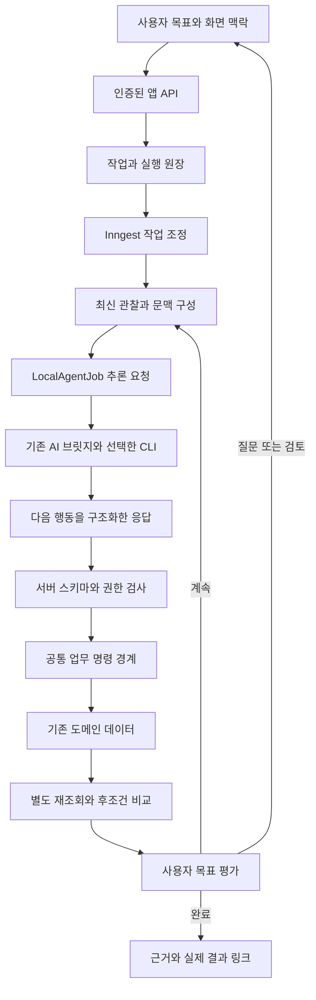

# 하박조팽 Agent Centric 앱 전환 계획

사용자 추가 요구인 **논문 먼저 읽기 → 발표 방향 2~3개 → 한 질문씩 Grilling → 대화하며 PT 제작**은 [전용 PT 제작 설계](./PAPER_PT_WORKSPACE.md)와 [phase 21](../../phases/21-paper-pt-workspace/index.json)에 구현·검증을 기록한다. 전용 제작 화면, 실제 Figure·표·설명 도식, HTML/PDF 내보내기를 추가했다. 아래 phase 20은 당시의 공통 작업 기반과 검토 저장 범위다. 운영 반영은 로컬 검증과 구분한다.

2026-10-18 구현·검증 기준. 첫 적용은 **논문 읽기, 검토 후 노트 저장, 세미나 발표 자료 생성**이다. 목표를 받아 조회·초안 작성·검토한 변경·결과 확인까지 이어가는 앱을 만든다.

사용자의 진행 및 세미나 생성 요구를 PRD·ADR-031·RULES에 반영했다. 아래 전체 전환 설계 중 이번 범위는 다음과 같다.

- `/presentations`의 **세미나 만들기** 또는 논문이 첨부된 `/ai-chat`에서 시작한다. 서버 읽기 → 근거 검증 → 초안 편집 → 명시적 등록 → 실제 저장 재조회를 구현한다.
- 세미나는 제목·시간·소개·핵심 내용·3~16장 텍스트 슬라이드이며 `Presentation.sourcePaperId`로 원문을 연결한다. PDF/PPTX 내보내기·일정 편성·라이브 제어는 후속 범위다.
- `AgentTask/AgentOperation`과 기존 브릿지·Inngest를 사용한다. `AGENT_TASKS_ENABLED=1`, 새 DB 스키마, `agent_step_v1` 브릿지가 필요하다. 운영 적용은 로컬 검증과 별도다.
- observation은 서버 도메인 상태다. 별도 화면 관찰 브릿지·다중 탭 revision·선택적 기억은 아직 없다. 인용의 존재·저장 무결성을 검사하며 질문 개수·연구 해석·발표 품질은 사용자가 검토한다.

## 자료에서 가져올 설계 원칙

기준 자료는 [AsideToMOA 40장 v3](../../AsideToMOA_40slides_dark_v3.html)다. 자료의 일곱 레이어는 책임을 구분하는 지도이며, 일곱 서비스를 새로 만드는 요구가 아니다.

| 슬라이드 | 하박조팽에 적용할 내용 |
| --- | --- |
| 9~11 | 요청을 목표·조건·완료 기준으로 만들고, UI와 에이전트가 같은 업무 상태를 사용한다. |
| 12~14 | 화면 선택·비활성 이유와 서버의 실제 저장 상태를 구분해 관찰한다. 관찰에는 범위·시각·버전을 붙인다. |
| 15~19 | 현재 상태, 재사용할 기억, 이번 모델 입력, 실행 재개 기록을 구분한다. 작업 중 질문·조건 변경·중지를 지원한다. |
| 20~24 | 업무 의미가 분명한 도구부터 만든다. Batch·REPL은 필요성이 측정된 뒤 검토한다. |
| 25~30 | 실행 후 별도 조회, 사용자 목표 평가, 권한 재검사, 중복 방지, 복구를 실행 과정에 포함한다. |
| 32~39 | 기존 연결을 재사용하면서 관찰과 후조건을 넓힌다. 비교 실험의 판정 기준은 실행 전에 고정한다. |

MOA의 전후 각 3회 기록은 그 앱의 제한된 실험이다. 하박조팽의 성공률·속도 개선 수치로 사용하지 않는다.

## 현재 기반과 확장할 부분

| 책임 | 현재 코드에서 확인한 기반 | 전환에 필요한 확장 |
| --- | --- | --- |
| User Intent | 자유 질문, `@` 자료 선택, 전송·중지 | 대화와 연결된 목표·조건·완료 기준, 조건 변경 |
| Observation | RSC 서버 조회, 팀별 논문·발표 자료 조회 | 에이전트용 상태 DTO, 화면 맥락, 가능한 행동과 막힌 이유 |
| Memory | 개인 대화 이력, 턴별 자료 보존 | 재사용할 선호·규칙의 선별 저장·검색·정정. MVP 이후 |
| Context | `lib/research-chat/context.ts`의 서버 문맥 구성 | 최신 도구 결과·관찰 버전·작업 상태·입력 예산 포함 |
| Agent Runtime | `connector/core/runtime.mjs`의 claim/result·취소·허가 관리 | 여러 판단과 업무 행동을 잇는 제한된 작업 루프 |
| Execution | Server Action과 도메인별 API, 로컬 추론 큐 | 공통 업무 명령 경계와 도구 스키마 |
| World & State | Prisma의 논문·분석·노트·자료·일정·라이브 | 작업·실행 원장, 대상 버전·멱등성 연결 |
| 공통 Harness | 2분 grant, 팀·소유자 검사, sequence/CAS, Inngest | 작업 단위 검토·체크포인트·실행 검증·목표 평가·구간 기록 |

`connector/core/adapters.mjs`는 현재 도구·셸·브라우저·MCP를 제한하고 텍스트 추론을 실행한다. Codex App Server 연결은 현재 모델·계정·한도 확인에 쓰인다. 이 연결이 이미 앱 업무 도구를 실행하는 것은 아니다.

실제 노트 쓰기는 `app/(app)/papers/[id]/actions.ts`, 일정 쓰기는 `app/(app)/schedule/actions.ts`에 있다. 설계 문서의 엔드포인트 목록을 그대로 구현 완료 목록으로 간주하지 않는다.

운영 기준선을 확인할 때에는 [19단계 배포 기록](../../phases/19-free-ai-chat-release/index.json)의 소스·운영 커밋과 설치 파일을 대조한다. 이 기록은 자유 채팅의 배포·실대화 확인을 남겼으며, 이전 문서의 미배포 설명과 시점이 다르다.

## 첫 번째로 완성할 사용자 흐름

예시 요청은 “첨부한 논문의 Contribution과 한계를 읽고, 반론 세 가지와 토론 질문 다섯 개를 노트 초안으로 정리해줘”다.

1. 현재 팀과 첨부 논문을 확인한다. 제목만 비슷한 논문을 임의로 같은 대상으로 취급하지 않는다.
2. 원문 준비 상태와 기존 분석·섹션 노트를 조회한다. 미준비 원문은 기존 Inngest 경로로 준비한다.
3. 필요한 페이지를 읽고, 근거와 해석을 구분한 초안을 만든다. 본문에 없는 내용은 추가 검증이 필요한 질문으로 표시한다.
4. 사용자는 `/ai-chat`에서 초안·근거·저장할 관점과 섹션을 검토하고 편집한다. **초안까지만 요청했다면 여기서 목표 완료**다.
5. 사용자가 검토한 내용을 저장하도록 지시하거나 저장 버튼을 누르면, 그 내용과 대상에 묶인 명령을 실행한다.
6. 별도 조회로 실제 노트의 내용·논문·관점·섹션·작성자를 확인한다. 중복 저장 없이 실제 노트 링크를 반환한다.
7. 화면 표시까지 요청한 경우에는 해당 화면의 최신 관찰도 확인한다. 원장 저장과 화면 갱신 결과를 각각 기록한다.

“이번 주 논문”처럼 대상이 불분명하면 필요한 자료를 질문한다. 현재 `ScheduleWeek`에는 `presentationId`가 있지만 `paperId`는 없으므로, 일정의 주제만으로 발표 논문 연결을 확정하지 않는다.

이 흐름의 완료 근거는 **실제 원문 참조, 검토한 초안, 요청했다면 저장된 노트**다. 인용 페이지·문구가 존재한다는 검증과 연구 해석의 타당성은 구분하며, 연구 판단은 사람이 검토한다.

## 사용자에게 보일 변화

`/ai-chat`을 자유 대화와 작업 진행의 중심으로 확장한다. 기존처럼 자료 없이 질문할 수 있고, 입력창에 모델·effort·카테고리 선택을 다시 넣지 않는다. 연결 설정의 위치도 유지한다.

작업이 생기면 대화 안에서 다음 정보를 보여 준다.

- 요청한 목표와 선택한 자료, 현재 단계, 기다리는 이유.
- 읽은 자료의 근거 링크와 검토할 결과물.
- 공유 저장이 필요한 경우 대상·내용의 미리보기와 편집·저장.
- 중지·조건 변경·재개, 완료한 실제 객체로 이동.

실패·입력 대기·연결 만료를 모두 “처리 중”으로 표시하지 않는다. 원시 도구 JSON과 내부 실행 로그는 기본 대화 화면에 노출하지 않는다.

논문 상세는 research/repro 두 관점과 공통 Figure를 유지한다. 별도 에이전트 탭·사이드패널을 추가하지 않는다. 기존 섹션 노트 영역을 검토·저장의 도착점으로 사용한다. 다른 화면의 요청은 현재 객체 참조를 포함해 `/ai-chat`으로 이어갈 수 있다.

홈에는 후속 단계에서 **내 진행 작업·검토할 초안·이번 주 준비 상태**를 추가한다. 처음부터 홈 전체를 바꾸기보다 실제 작업이 생겼을 때 그 상태를 보여 준다. 개인 작업은 본인에게만, 공유된 노트·일정은 기존 팀 권한으로 표시한다.

## 실행 구조 제안



첫 구현안은 **기존 텍스트 추론을 재사용하는 제한된 앱 작업 루프**다. 모델은 `read`·`draft`·`ask`·`finish` 등의 구조화된 다음 행동을 제안하고, 서버가 허용 목록·스키마·범위·권한을 확인한 뒤 실행한다. 모델의 출력 문자열 자체에는 실행 권한이 없다. 공유 저장은 별도의 검토된 명령만 받는다.

`LocalAgentJob`에 `purpose=agent_step` 같은 구분과 작업 단계 연결을 추가하는 방안을 검증한다. 현재 `createPreparedJob`은 `paper_analysis|chat`만 받으므로 그대로 호출해서는 안 된다. 연결기도 작업 문맥 종류와 지침을 구분해야 하며, 일반 자유 답변·논문 분석은 기존 경로를 보존한다. 새 문맥·응답 계약의 지원 능력을 보고한 연결기에만 해당 작업을 claim하도록 해 구버전 설치앱과 혼동하지 않는다.

Inngest는 단계 저장·짧은 조회·durable 대기를 담당한다. 웹 요청은 작업을 적재하고 즉시 응답한다. CLI 추론은 승인한 PC에서 실행한다. 일반 서버리스 요청이나 메모리 Promise를 추론 완료까지 유지하지 않는다.

이 방식은 공급자별 네이티브 도구 호출 지원 여부와 분리해 첫 흐름을 검증할 수 있다. 초안 기준 상한은 모델 판단 6회, 업무 도구 10회, 실행 시간 10분이며 사용자 입력 대기는 실행 예산과 구분한다. 잘못된 구조화 출력은 한 차례만 보정하고 반복 무진전은 중단 사유로 반환한다. 수치는 평가 후 조정한다.

연속 추론의 지연·품질이 병목으로 확인되면, 현재 설치 CLI의 공식 계약을 검증한 뒤 네이티브 도구 호출 어댑터를 비교한다. 셸·파일·브라우저 전체 권한을 켜는 방식으로 업무 도구를 대신하지 않는다.

## 관찰과 업무 도구의 계약

화면 관찰은 `viewInstanceId`, 경로·객체·관점, 선택한 자료, 편집 중 여부, 보이는 오류·비활성 이유, `observedAt`, `screenRevision`을 갖는다. **화면 표시 정보는 display_only**다. 여러 탭을 하나의 “현재 화면” 값으로 덮어쓰지 않으며, 늦게 도착한 이전 탭·팀의 관찰은 사용하지 않는다.

서버 관찰은 검증된 팀·객체, 원문 digest, 분석 요청 식별자, 업무 버전, 가능한 행동과 제한 이유를 제공한다. 화면 revision과 DB 버전은 다른 값이다. 읽을 수 없거나 오래된 관찰은 재조회하며, 가능한 행동 안내를 최종 인가로 사용하지 않는다.

MVP의 도구 이름과 필드는 아래의 제안이다.

| 도구 | 역할 | 실제 상태에 대한 효과 |
| --- | --- | --- |
| `workspace.observe` | 현재 객체·준비 상태·가능한 행동 조회 | 읽기 |
| `paper.read` | 허용한 논문의 페이지별 본문·digest 조회 | 읽기 |
| `paper.read_analysis` | 두 관점 분석과 공통 Figure 메타데이터 조회 | 읽기 |
| `notes.list` | 대상 섹션의 기존 팀 노트 조회 | 읽기 |
| `task.prepare_note` | 근거·관점·섹션을 포함한 개인 초안 생성 | 개인 작업 기록만 변경 |
| `notes.save_reviewed` | 사용자가 검토한 정확한 초안을 노트로 저장 | 공유 도메인 쓰기 |

미준비 원문의 준비는 기존 잡 경로에 위임한다. 업로드만으로 분석을 시작하지 않는다. 기존 두 관점 분석을 새로 실행하려면 기존의 PC·제공자·실제 모델 선택과 명시적 시작 절차를 따른다.

각 도구는 입력·출력 스키마, 대상 범위, 부작용, 권한, 버전 전제, 오류, 재시도 의미, 검증 방법을 정의한다. `teamId`·소유자·작성자·유효 grant는 서버가 결정한다. `operationId`와 멱등성 키도 서버가 발급해 모델이 중복 방지 규칙을 바꾸지 못하게 한다.

사람의 Server Action과 에이전트 명령은 같은 서버 도메인 서비스를 사용한다. 노트 쓰기를 추출할 때 기존의 팀 검사·작성자 주입·Figure의 `lens:any`를 함께 보존한다. durable runner가 쿠키 기반 Server Action을 직접 흉내 내거나 도메인 규칙을 별도로 복사하지 않는다.

## 작업 상태와 검토 정책

대화 턴, PC 추론 작업, 앱의 목표를 구분한다. `ResearchConversation`은 대화, `LocalAgentJob`은 한 번의 PC 추론, 새 작업 원장은 여러 단계가 필요한 목표를 보관한다.

초기 저장 모델은 두 종류를 우선 검토한다.

| 모델 제안 | 보관할 내용 |
| --- | --- |
| `AgentTask` | 팀·소유자·대화 연결, 생성 요청 키, 목표·조건·완료 기준, 목표 revision, 상태·대기 이유, 단계 예산·체크포인트 |
| `AgentOperation` | 단계·도구·입력 digest·대상 버전, 연결된 추론 작업, 검토한 초안·검토 증거, 멱등성 키, 결과 객체·검증 근거·실패 |

초안·근거 JSON은 버전과 서버 스키마를 갖는다. 별도 범용 메모리·벡터 DB·워크플로 엔진은 첫 구현에 추가하지 않는다. 작업 생성 요청 키는 팀·소유자 범위에서 고유하게 처리한다. Operation의 상태 전이는 CAS로 처리하며, 이미 실행한 입력과 검토 증거를 이후 편집으로 바꾸지 않는다.

작업 저장과 Inngest 이벤트 전달 사이의 실패도 복구한다. 같은 작업 ID의 중복 전달은 새 작업을 만들지 않고, 전달이 누락된 대기 작업은 원장 상태에서 재조정한다. 이벤트 발송 성공만으로 단계 완료를 기록하지 않는다.

작업은 `queued → running → waiting_input | waiting_review | waiting_connection → completed | failed | cancelled`로 표현한다. 각 waiting 상태는 조건 충족 후 최신 상태를 읽어 `running`으로 복귀한다. 실행 결과가 불명확한 Operation은 `reconciling`으로 두고 먼저 실제 반영을 조회한다.

- 요청한 범위의 조회와 개인 초안 작성은 작업 안에서 이어간다. 도구 호출마다 확인창을 띄우지 않는다.
- 새로 생성한 내용을 공유 노트로 옮길 때에는 정확한 대상·관점·섹션·본문을 검토한다. 사용자가 이미 그 내용과 대상을 지정해 저장을 지시했다면 같은 확인을 반복하지 않는다.
- 검토 증거는 사용자·팀·task revision·초안 digest·대상 버전·유효 기간에 묶는다. 내용·대상·목표가 바뀌면 이전 검토로 실행하지 않는다.
- 실행 직전에 현재 멤버십·권한·grant·취소 상태를 다시 검사한다. 필수 검사는 Hook의 유무와 관계없이 공통 명령 경계에서 강제한다.
- 노트 작성자는 저장한 사용자로 기록한다. AI 초안이라는 출처를 보존하되 개인 대화·비공개 작업 본문을 팀원에게 노출하지 않는다.

2분 grant와 웹만 갱신하는 원칙을 유지한다. 웹 종료 뒤 계속 새 추론·업무 쓰기를 하지 않는다. 유효 허가 중 이미 접수한 결과의 검증·개인 초안 저장은 기존 후처리 경계를 따르며, 이를 만료 후 새로운 공유 변경의 권한으로 사용하지 않는다.

## 실행 검증과 복구

`notes.save_reviewed`는 노트 저장과 Operation의 결과 객체 연결을 같은 트랜잭션으로 처리한다. 같은 작업·명령 키의 재전송은 기존 결과를 반환한다. 같은 키의 다른 내용은 충돌로 거절한다. 타임아웃 뒤에는 Operation과 노트를 먼저 조회하고, 새 노트를 무조건 다시 만들지 않는다.

실행 검증은 쓰기 반환값을 그대로 승인하지 않고 별도 조회로 다음을 비교한다.

- 대상 논문과 활성 팀, 실제 노트 ID, 관점·섹션·작성자, 검토한 제목·본문.
- 초안이 사용한 원문 digest와 대상 분석 버전의 유효성.
- 화면 표시가 목표에 포함됐다면 해당 탭의 최신 노트 표시와 화면 revision.

원장 불일치·화면 미갱신·화면 관찰 불가를 구분한다. `router.refresh()`를 호출했다는 사실만으로 화면 표시 완료를 보고하지 않는다.

목표 평가는 이 검증 결과와 요청의 완료 기준을 비교한다. “초안 작성”과 “공유 저장”은 다른 목표다. 객관적 대상·개수·저장 조건은 규칙으로 확인하고, 연구 내용의 적절성은 근거와 함께 사용자 검토로 보완한다.

조건 변경은 task revision을 올리고 이전 계획·미실행 명령·검토를 무효화한다. 늦게 도착한 추론 결과도 해당 단계·목표 revision을 대조해 현재 계획을 덮어쓰거나 새 명령을 실행하지 못하게 한다. 중지와 쓰기의 경합은 실제 커밋 상태를 기준으로 결과를 알린다. 이미 저장된 노트를 취소 처리로 숨기거나 몰래 삭제하지 않는다. 재개 시에는 현재 로그인·팀·기기를 확인하고 새 실행 허가를 명시적으로 연결한다.

PDF·댓글·자료 본문은 신뢰할 수 없는 자료다. 본문 속 지시를 실행 지침이나 검토 승인으로 사용하지 않는다. 모델 입력에는 서버가 허용한 자료와 검증된 결과만 포함하고, 원시 비밀·쿠키·파일 경로·서명 URL은 넣지 않는다.

## 구현 순서

첫 MVP는 아래 0~5단계로 나누고, 범위가 정해지면 `phases/20-agent-centric-foundation/stepN.md`와 상태 index로 구체화한다. 각 단계는 실패 테스트부터 작성한다.

| 단계 | 구현할 범위와 주요 경로 | 통과 기준 |
| --- | --- | --- |
| 0. 제품·계약 확정 | PRD·ADR·ISSUES, 작업·관찰 DTO와 격리 fixture 설계 | 첫 시나리오·쓰기 정책·완료 기준·실행 예산 확정. 차단 결정은 ISSUES에 기록 |
| 1. 관찰과 읽기 | `types/agent-task.ts`, `lib/agent/observation.ts`, 읽기 도구·API, 화면 맥락 전달 | 팀 격리, stale·다중 탭, 비활성 이유, 빈 상태를 검증하는 테스트 통과 |
| 2. 작업 실행 | Prisma 작업 원장, `lib/agent/`, `worker/agent-task.ts`, `purpose=agent_step`와 브릿지 문맥 구분 | 여러 읽기→초안까지 durable 실행. 스키마 오류·무진전·grant 만료 시 정해진 대기/종료 |
| 3. 검토 경험 | `components/research-chat/`의 작업 상태·근거·초안 편집·조건 변경 | 자유 질문·자료 선택·연결 설정 회귀 없음. 새로고침 후 작업과 검토 초안 복원 |
| 4. 첫 공유 쓰기 | 공통 노트 서버 서비스, 검토된 저장 명령, 독립 재조회 | 검토한 내용만 한 번 저장. 기존 작성자·팀·Figure 규칙 유지. 실제 노트로 이동 |
| 5. 실패 복구와 평가 | 중지·재개·경합 테스트, 격리 E2E, 기준선 비교·배포 문서 | 아래 실패 사례와 사용자 목표 검증을 통과하고 운영 변경안을 검토할 수 있음 |

이후 확장은 동일한 도구·검증 경계에 업무를 하나씩 추가한다.

1. **일정과 발표 준비:** 요청한 달의 초안·순번·충돌 설명, 검토 후 저장. 기존 `ScheduleMonth.version`과 순번 계산을 사용한다. 조회나 월 이동이 월 row를 만들지 않는다.
2. **발표 자료와 회고:** 기존 자료·팀 노트에 근거한 발표 개요와 후속 질문 초안. PDF 전용 업로드 규칙을 유지한다.
3. **작업 중심 홈과 선택적 기억:** 진행 작업·검토할 결과물을 홈에 연결한다. 개인 선호와 팀 규칙은 별도 범위·출처·갱신일·정정/삭제 경로로 저장한다. 다른 사람의 개인 대화를 기억 검색에 포함하지 않는다.
4. **실행 표현 확장:** 실제 병목이 있을 때 읽기 Batch·네이티브 도구 호출·제한된 코드 실행을 비교한다. 업무 권한·부분 실패·멱등성 계약은 동일하게 유지한다.

라이브 전체 종료, 멤버 권한 변경, 출석·벌금 확정, 외부 메시지 발송은 각각의 제품 정책을 정한 뒤 추가한다. 세미나 녹음·녹화 수집과 OCR·이미지 기반 Figure 이해도 별도 범위다.

## 검증과 측정

필수 시나리오는 정상 완료, 원문 준비 실패, 근거 없는 주장, 교차 팀 객체, 다른 사용자의 개인 작업, 오래된 관찰, 두 탭, 원문 교체, 검토 후 내용 변경, 중복 저장, 응답 유실, 취소와 커밋 경합, 로그아웃·팀 전환·멤버 제거, 재로그인 후 재개다. 모바일 390px과 데스크톱에서 초안 검토·저장·결과 이동도 확인한다.

운영 DB를 사용하는 기본 Playwright 설정 대신 기존 격리 검증기를 확장한다. 새 `agent-task.spec.ts`를 `playwright.local-agent.config.ts`의 명시적 `testMatch`에 추가하고, 검증기의 대상 테스트 목록과 fixture에도 반영한다.

```bash
npm run test:isolated
npm run connector:test
npm run test:local-agent:e2e
npm run test:local-agent:wire
npm run lint
npm run build
```

각 명령의 실제 대상 범위를 단계 설계에서 확인한다. PostgreSQL의 멱등성·동시 커밋 검증은 기존 일회용 PG 검증 경로에 추가한다. 실행기 자체를 바꾸면 `python -m pytest scripts/test_execute.py`도 수행한다. Windows 보조 프로세스는 기존 숨김 실행·출력·종료 코드 보존 규칙을 따른다.

비교 평가는 동일한 모델·자료·권한·초기 상태·캐시 조건에서 **현재 자유 채팅**과 **관찰·도구·검증을 추가한 작업 흐름**을 비교한다. 판정 기준을 먼저 기록하고 과제별 반복 측정한다. 목표 달성, 정확한 후조건, 근거 무결성, 중복·무권한 변경, 복구, 사람 개입, 관찰·추론·도구·검증별 시간을 남긴다. 토큰은 공급자가 제공한 관측값만 기록하고 없으면 미측정으로 둔다. 작은 표본에서 일반 성공률·속도 우위를 주장하지 않는다.

운영 전환은 읽기·개인 초안부터 기능 플래그로 적용하고, 공유 쓰기를 별도로 켠다. 중단 시 신규 실행을 막되 완료한 도메인 변경과 작업 이력은 보존한다. 스키마 SQL·롤백 절차·설치앱 호환성을 검토한 후 운영 적용 단계로 진행한다.

## 구현 전에 합의할 결정

| 결정 | 우선 제안 | 영향 |
| --- | --- | --- |
| 첫 흐름 | 논문 읽기·세미나 준비와 검토 후 섹션 노트 저장 | 첫 도구·평가 fixture의 범위 |
| 공유 변경 | 생성 초안은 정확한 내용과 대상을 검토한 뒤 저장. 이미 지정한 저장 지시는 반복 확인 없음 | PRD §5.8·12, RULES R14·42, 새 ADR |
| 실행 시간 | 현재의 웹 세션·2분 grant 유지 | 웹 종료 후 자율 수행은 별도 권한 설계가 필요 |
| 초기 실행 계약 | 텍스트 추론+서버가 검증하는 구조화된 행동 제안 | 전용 purpose·문맥 지침·실패 복구 검증 |
| 화면 변화 | 기존 자유 채팅을 작업 공간으로 확장하고 홈은 후속 연결 | 입력창 간결함·논문 두 관점 유지 |

## 참고 경로

- [제품 정본](../user/PRD.md), [불변 규칙](../agent/RULES.md), [결정 기록](../agent/ADR.md), [미결 사항](../agent/ISSUES.md)
- [현재 자유 AI 채팅 UX](./LOCAL_AI_RESEARCH_CHAT.md), [디자인 가이드](./DESIGN_GUIDE.md)
- [아키텍처](../dev/ARCHITECTURE.md), [DB와 수동 적용 절차](../dev/DB.md), [보안 경계](../security/SECURITY.md)
- [로컬 연결 계약](../../lib/local-agent/PROTOCOL.md), [추론 어댑터](../../connector/core/adapters.mjs), [연결기 실행](../../connector/core/runtime.mjs)
- [연구 채팅 문맥](../../lib/research-chat/context.ts), [작업 적재와 결과 접수](../../lib/local-agent/service.ts)
- [섹션 노트 Server Action](../../app/(app)/papers/[id]/actions.ts), [일정 Server Action](../../app/(app)/schedule/actions.ts)
