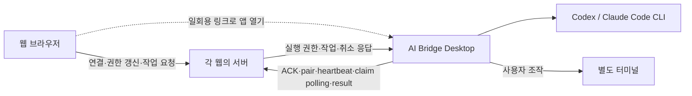

# AI Bridge의 로컬 허브와 웹 연동 경계

AI Bridge는 여러 웹의 연결과 내 PC의 AI 실행을 관리하는 설치 앱이다. 첫 연동 대상은 하박조팽이다. 첫 연동을 확인한 뒤 두 번째 웹으로 재사용 가능성을 검증하고, 그 결과를 바탕으로 공통 SDK를 분리한다.

## 승인한 이름

| 이름 | 역할 | 현재 코드와의 관계 |
| --- | --- | --- |
| AI Bridge | 사용자에게 보이는 제품명. 한국어 화면에는 AI 브릿지를 사용한다. | 설치 앱의 표시 이름이다. |
| `ai-bridge-desktop` | 웹 연결·권한과 로컬 CLI 실행을 관리하는 설치 앱. | 현재 `connector/desktop`과 `connector/core`에 해당한다. |
| `ai-bridge-web-sdk` | 각 웹이 공통 연결 계약을 사용할 수 있게 하는 브라우저·서버 통합 도구. | 추출할 구성이다. 아직 독립 SDK 패키지는 없다. |
| `hapark-adapter` | 하박조팽의 인증·팀·논문·대화 데이터를 공통 계약에 연결하는 웹별 구현. | 현재 웹의 `components/local-agent`, `app/api/local-agent`, `lib/local-agent` 등에 나뉘어 있다. |

`connector/core/adapters.mjs`는 Codex와 Claude Code를 실행하는 **CLI 어댑터**다. 웹별 어댑터와 구분한다. 구성 이름을 정하는 작업은 기존 appId, `hapark-connect` 링크, 암호화된 프로필 경로를 변경하지 않는다.

## 로컬 앱이 맡는 일

`ai-bridge-desktop`은 CLI의 설치·로그인 상태와 사용 가능한 모델을 확인한다. 사용자는 웹 연결 전에도 CLI 상태를 확인하고 별도 터미널을 열 수 있다. 직접 연 터미널은 사용자가 관리한다. 현재 업데이트된 브리 캐릭터의 이미지·표정·애니메이션과 작은 펫 동작은 유지한다.

웹 요청의 자동 실행에는 해당 웹의 승인과 유효한 실행 권한이 필요하다. 로컬 앱은 실제 CLI 프로세스의 시작과 종료를 근거로 실행 상태를 표시한다. 사용 가능한 CLI, 다음 요청의 모델 선택, 실행 중인 CLI는 서로 다른 상태다.

CLI 로그인 정보, 실행 경로, 프로세스 인자와 환경 변수는 로컬에 둔다. 웹이나 작은 펫으로 보내지 않는다. 웹이 임의 셸 명령을 전달해 실행하는 기능은 공통 연결 계약에 포함하지 않는다.

## 웹 SDK와 웹별 어댑터가 맡을 일

`ai-bridge-web-sdk`의 분리 대상에는 브라우저와 서버 양쪽이 있다. 브라우저는 설치·연결·모델 선택과 요청 상태를 다룬다. 서버는 웹 사용자의 인증과 권한을 확인하고, 만료 가능한 실행 권한·작업·결과를 관리한다.

웹별 어댑터는 그 웹의 로그인, 조직 권한, 데이터 저장소와 요청 문맥을 연결한다. 하박조팽의 논문과 연구 채팅 의미는 이 경계가 맡는다. 로컬 앱이 웹별 데이터베이스 구조를 알아야 하는 설계는 피한다.

현재 CLI 실행 코드에는 연구 지침과 `research_chat`, `agent_task`, `paper_context` 해석이 남아 있다. 따라서 폴더만 옮겨서는 범용 SDK가 되지 않는다. 두 번째 연동에서 이 결합을 확인하고, 검증된 계약만 분리한다.

## 현재 통신 방식

현재 로컬 앱은 등록된 웹 서버의 HTTP API를 호출하고 작업을 polling한다. 브라우저와 로컬 앱 사이에 상시 소켓을 여는 구조는 아니다. 서버의 권한이 만료되거나 회수되면 자동 작업을 중단한다. 저장된 기기 정보만으로 실행 권한을 되살리지 않는다.

## 현재 범위와 확장 지점

현재 설정은 복수 application 항목과 앱 ID별 암호화 저장을 표현할 수 있다. API 클라이언트도 등록된 origin을 받는다. 그러나 활성 `selectedApp`과 `runtime`은 각각 하나다. 여러 웹의 연결을 동시에 유지하는 허브는 아직 구현하지 않았다.

1차 작업은 첫 웹의 설치·연결 UI, 로컬 CLI 상태, 자동 실행 표시, 터미널 열기와 메뉴를 정리한다. 웹 UI는 하나의 연결 창으로 모아 모델을 바꿔도 작성 중인 대화와 선택 자료를 유지한다. 이 단계에서 SDK 패키지 추출이나 복수 runtime을 추가하지 않는다.

## 다음 순서와 완료 기준

| 순서 | 할 일 | 완료 기준 |
| --- | --- | --- |
| 1. 첫 연동 확인 | 하박조팽의 설치·연결·자동 실행·취소·재연결과 별도 터미널 열기를 확인한다. | 연결·CLI 사용 가능·실제 실행 상태를 구분하고, 요청 결과가 웹으로 돌아오며, 취소와 권한 만료가 자동 실행을 멈춘다. |
| 2. 두 번째 웹 검증 | 논문 기능이 없는 작은 웹을 독립 origin·인증·작업 저장소로 연결한다. | 같은 로컬 앱을 사용하고, CLI 실행 코드를 복사하거나 하박조팽 논문 DB를 요구하지 않는다. 한 웹의 토큰과 결과가 다른 웹으로 넘어가지 않는다. |
| 3. 공통 SDK 분리 | 두 연동에서 확인한 계약을 `ai-bridge-web-sdk`로 추출한다. | 두 웹이 같은 연결 계약을 사용하면서 각자의 인증·데이터 로직을 유지한다. 구버전과 지원하지 않는 계약 버전의 동작을 재현한다. |
| 4. 여러 웹 연결 관리 | 필요가 확인되면 웹별 세션과 로컬 전체 실행 순서 정책을 추가한다. | 소유 웹·대기·실행 상태가 보이고, 한 웹의 중지·만료가 다른 웹의 작업을 취소하지 않는다. |

초기 다중 연결 정책의 제안은 **연결은 여러 개 유지하고 자동 실행은 전체 한 개로 제한하는 것**이다. 여러 웹 연결과 여러 CLI 동시 실행은 별도 기능으로 다룬다. 다음 작업을 시작하기 전에 이전 프로세스 종료를 확인한다.

추가로 정할 제품 정책은 웹 등록 방식, 같은 웹의 복수 계정, 작업 순서와 웹별 동시 실행 범위다. 브라우저 종료 후에도 실행하려면 현재 웹 승인 갱신 정책과 별도로 검토한다.

## 확인할 코드

- [로컬 앱과 연결 선택](../../connector/desktop/main.mjs).
- [등록 origin·전용 링크 검증](../../connector/core/security.mjs).
- [앱별 기기 정보 저장](../../connector/core/storage.mjs).
- [실행 권한·작업 처리](../../connector/core/runtime.mjs).
- [CLI 실행과 현재의 웹 도메인 결합](../../connector/core/adapters.mjs).
- [현재 웹 연결 상태 소유자](../../components/local-agent/provider.tsx).
- [서버 연결·작업 권한](../../lib/local-agent/service.ts).
- [현재 통신 계약](../../lib/local-agent/PROTOCOL.md).
